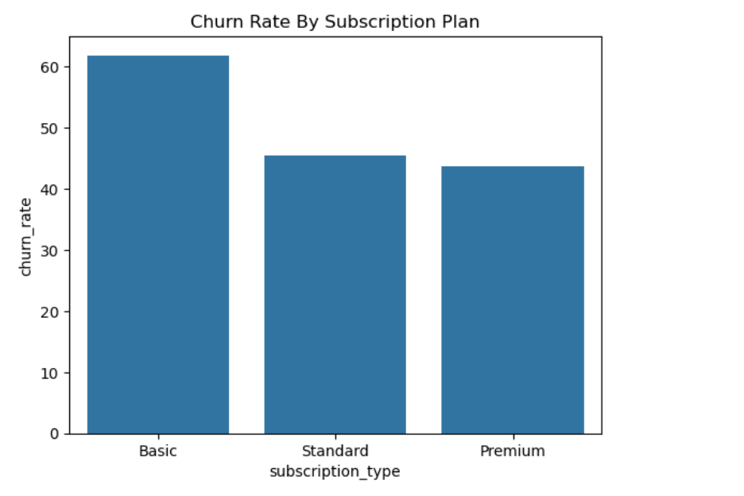
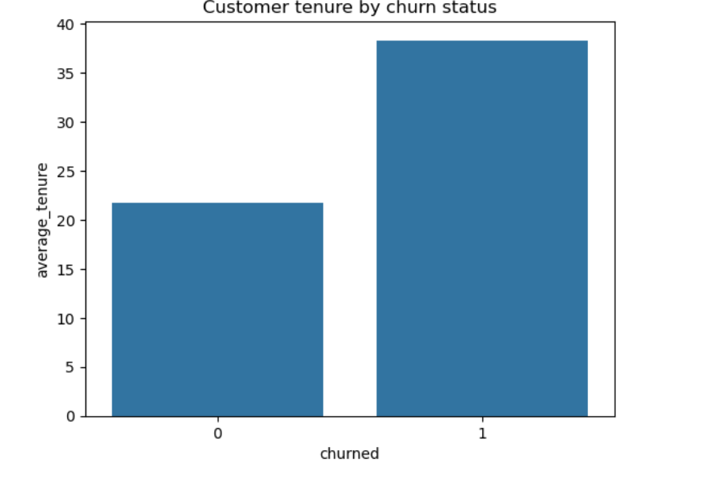
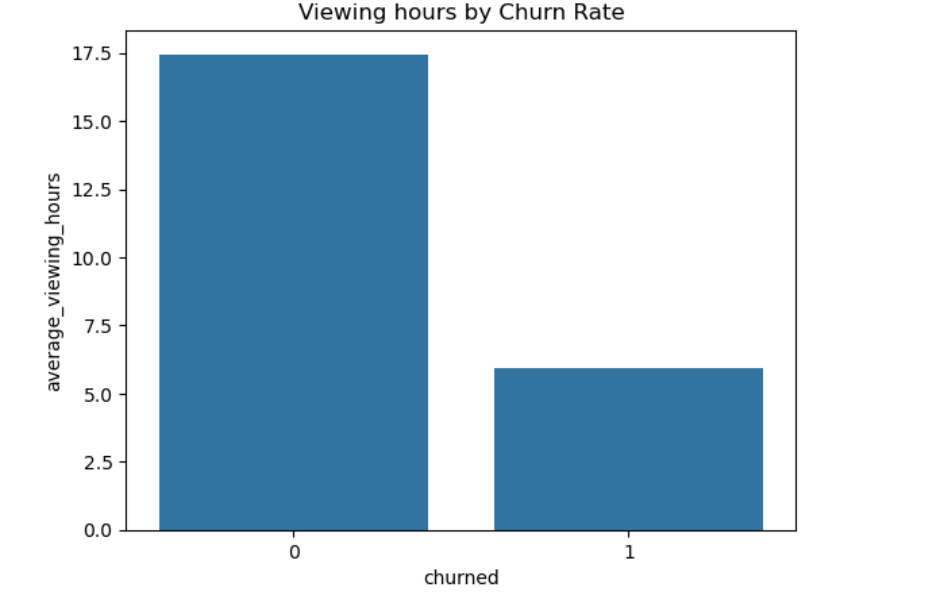
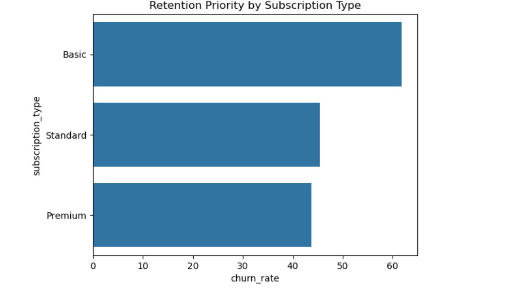

# netflix_customer_churn
### Churn rate by Subscription Plan

### Customer Tenure By Churn Status

### Viewing Hours by Churn Rate

### Retention Priority By Subscription Plan

## Key Data Insights
•	According to the calculations and visualizations, the customers who purchased the Netflix basic subscription plan have the highest average churn rate at 61.8%.
•	It is also observed that customer with churn=1 have a higher average tenure than customers with churn=0 which means customers who churned had stayed subscribed longer on average, than customers who remained.
•	It is also observed that customers who have not churned have higher daily viewing hours than customers who have churned with an average of 17.45 hours
•	Therefore, It can be concluded that the highest churn rate is seen in the Basic plan subscribers and the lowest churn rate is seen in the Premium plan subscribers.
## Business Recommendations
•	The dataset shows that majority of the churned customers had Action as their favorite genre.
•	This means the content in the Action genre can be improved so, that long term customers can be retained
 •	So, improvements are needed in the basic and standard subscription plans for better customer retention.
